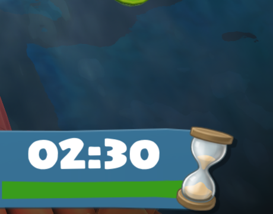

# 桌面透明外设电量查看工具（Peripheral Battery Widget）

一款 Windows 桌面小工具：把鼠标 / 键盘 / 手柄等外设的**剩余电量**以半透明小卡片的形式贴在桌面上，一眼看完，不联网、无广告、不弹窗。



## 功能

- **透明悬浮卡片**贴在桌面（可拖动、记住位置、透明度可调、可切浅色主题）
- **分组显示**：「精确电量」组显示精确百分比 + 平滑电量条；「档位电量」组（设备只肯报 4 档的）显示 `≈xx%` + 四格粗电量条
- **电量条变色**：>50% 绿、20~50% 黄、<20% 红
- **连接方式标签**：蓝牙 / 接收器 / 有线 / 充电中
- **低电量提醒**：跌破阈值（默认 20%，可调）弹 Windows 通知，之后每 30 分钟重复一次，直到插电
- **鼠标穿透**：卡片不再挡操作（托盘菜单或快捷键 `Ctrl+Alt+B` 切换）
- **设备管理**：自动发现、零配置；右键重命名；可隐藏不想看的设备；同一设备跨连接方式合并
- **托盘常驻 + 开机自启**（可在设置里关闭）
- 每 60 秒自动刷新；设备重连 / 电脑唤醒时立即刷新

## 实测设备支持情况（重要）

| 设备 | 连接方式 | 电量显示 | 说明 |
|---|---|---|---|
| 迈从 MCHOSE X75 V2 键盘 | 蓝牙 | ✅ 精确百分比 | 标准 BLE 电量服务（0x180F） |
| 迈从 MCHOSE A7 Ultra 鼠标 | 蓝牙 | ✅ 精确百分比 | 同上 |
| 盖世小鸡 Nova 2 Lite 手柄（T4N2） | 有线 / 2.4G接收器 | ✅ 精确百分比 | 已破解 T4N2 私有协议，见下文；按 MAC 识别，换连接方式昵称跟随 |
| 任何暴露标准 BLE 电量服务(0x180F)的设备 | 蓝牙 | ✅ 精确百分比 | 大部分蓝牙耳机 / 鼠标键盘适用 |
| XInput 报告电池的手柄（如 Xbox 360 无线手柄+官方接收器） | 2.4G 接收器 | ⚠️ 4 档（≈25/50/75/100%） | XInput 协议天生只有 4 档 |
| 其他盖世小鸡型号 | 任意 | ❌ 未验证 | 欢迎用 `probe/` 探针测试并反馈 |

### 盖世小鸡 T4N2 电量协议（逆向成果）

破解过程：GSC 的 `zw-lib` 日志直接吐出了报文。本工具**不需要 GSC 运行**即可独立读取。

- 查询（写入 65 字节 HID 报文）：`00 01 01 00` + 零填充
- 回应（65 字节）：`[0]=0x00 占位, [1]=0x01 类型, [2..7]=MAC, [19]=电量%(0-100), [20]=充电状态`
- 适用型号：productType 为 `T4N2` 的设备（如 Nova 2 Lite）；其他型号待验证

原则：**能读的都读出来，读不了的写明原因，绝不编造数字。**

## 使用

1. 双击 `PeripheralBatteryWidget.exe`（单文件、免安装，内置运行时）
2. 右下角托盘图标 → 右键菜单：显示/隐藏、鼠标穿透、立即刷新、设置、开机自启、退出
3. 悬浮窗上：**左键拖动**调整位置；**右键**弹出菜单（空白处=主菜单，设备行=重命名/隐藏）
4. 设置文件位于 `%APPDATA%\PeripheralBatteryWidget\settings.json`

## 构建方法（需要 .NET 10 SDK）

```bash
cd src
dotnet publish -c Release -r win-x64 --self-contained true \
  -p:PublishSingleFile=true -p:EnableCompressionInSingleFile=true -o ../dist
```

`probe/` 目录是开发期的"探针"控制台程序，用于实测各设备电量数据通道（BLE GATT / XInput / HID 私有报表），欢迎用它报告新设备的兼容性。

## V2 候选（当前未做）

- 更多盖世小鸡型号的电量协议验证（T4N2 之外：G7/T7/Kaleid 系列在 GSC 设备表中，可用 `probe/` 探针按 T4N2 命令试探）
- 皮肤 / 主题色自定义
- 点击设备行展开详情（厂商、连接历史、精确充电状态）
- 电量历史曲线

## 已知限制

- 盖世小鸡手柄经 2.4G 接收器连接时电量不可读（见上表），蓝牙直连模式的读取仍在研究中
- "档位"组的手柄在换槽位后昵称可能需要重新设置（按槽位识别）
- 启动瞬间内存占用较高（约 100+MB，含运行时初始化），稳定后回落

---

License: MIT
